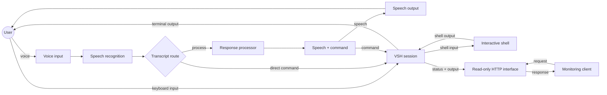

# vsh: Voice Shell

An interactive terminal controlled by voice, with local or cloud speech and AI providers.

## Features

- Control Bash, Zsh, or Fish by voice.
- Use Ollama, OpenAI, Anthropic, or any command-line AI.
- Pick local, cloud, or custom HTTP speech providers.
- Ignore steady background noise before transcription.

## How it works



Keyboard and voice commands operate on the same live shell session. The optional HTTP interface only observes it.

## Installation

The Nix package includes its native audio dependencies. For uv installs, install PortAudio; Linux also requires ALSA development libraries.

```bash
# uv
uv tool install git+https://github.com/creator54/vsh.git

# Nix
nix profile install github:creator54/vsh
```

- Local checkout: `uv tool install -e .`

## Usage

- `vsh`: start the shell.
  - `--voice`: start listening immediately.
  - `--verbose`: show logs.
  - `--echo`: return recognized speech without an AI.
  - `--serve [--instance-id NAME]`: expose read-only shell status and output over a private Unix socket; prints the socket path. IDs default to random and accept 1–32 ASCII letters, digits, underscores or hyphens.
- `vsh setup`: configure the shell, speech and AI providers, microphone, and keybind.
- `vsh bind`: change the VSH toggle keybind.
- `vsh stt [--file <audio.wav>]`: transcribe the microphone or a WAV file.
- `vsh tts "<text>" [--save <out.wav>] [--stream]`: speak or save text.

## Voice replies

- Format: `{"speech":"Opening it.","command":"cd ~/project"}`
  - Use `null` when there is no command.
  - Invalid JSON is shown as text and never run.
- Speech comes first.
  - TTS available: play it.
  - TTS off or failed: print it.
- Command comes next.
  - `auto_submit = true`: run it.
  - `auto_submit = false`: leave it editable.

## Environment overrides

- Shell and voice: `VSH_SHELL`, `VSH_VOICE`.
- AI provider: `VSH_LLM`, `VSH_LLM_KEY`.
- Output: `VSH_OUTPUT_MODE` (`speak_and_command`, `command_only`, or `speak_only`).
- Visual: `VSH_OVERLAY` (`auto`, `kitty`, or `none`).
- Voice command: `VSH_VOICE_HANDLER='command {}'`.
- Local bridge: HTTP over `$XDG_RUNTIME_DIR/vsh/<instance-id>.sock`, or `${TMPDIR:-/tmp}/vsh-<uid>/<instance-id>.sock` when `XDG_RUNTIME_DIR` is unset. The directory is 0700 and the socket is 0600; access is restricted to the same OS user (and privileged processes), without bearer tokens or a TCP listener. Unsafe existing directories are rejected, not repaired.
  - Read-only endpoints: `GET /health`, `GET /tools` (empty), `GET /io/output`. `/health` retains the existing shell state field; it is not a reliable command-readiness signal. `POST /execute_tool` remains disabled (410).
  - Example: `curl --unix-socket "$XDG_RUNTIME_DIR/vsh/demo.sock" http://localhost/health` after starting `vsh --serve --instance-id demo`.
  - Replaces `--port` and `VSH_SERVER_TOKEN`. Consumers must connect through the socket; do not forward it over TCP. Live paths and unrelated files are never overwritten; refused connections on owned stale sockets allow reclamation.

## Keybinds

- Press the configured keybind (default `Ctrl+\`), `Ctrl+G`, or `Ctrl+]` to toggle voice capture.
  - Off: remove the voice indicator and restore the normal cursor.
  - On: follow the system microphone's mute state (Linux/PipeWire).
